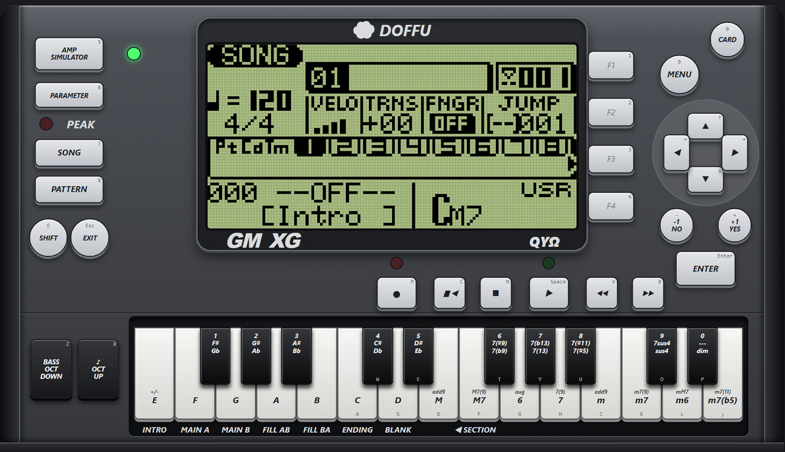
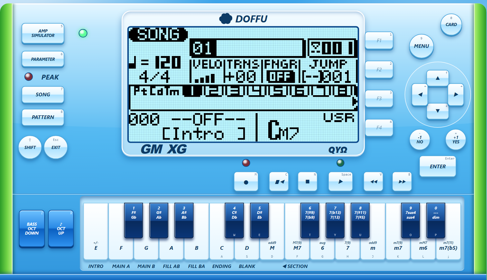
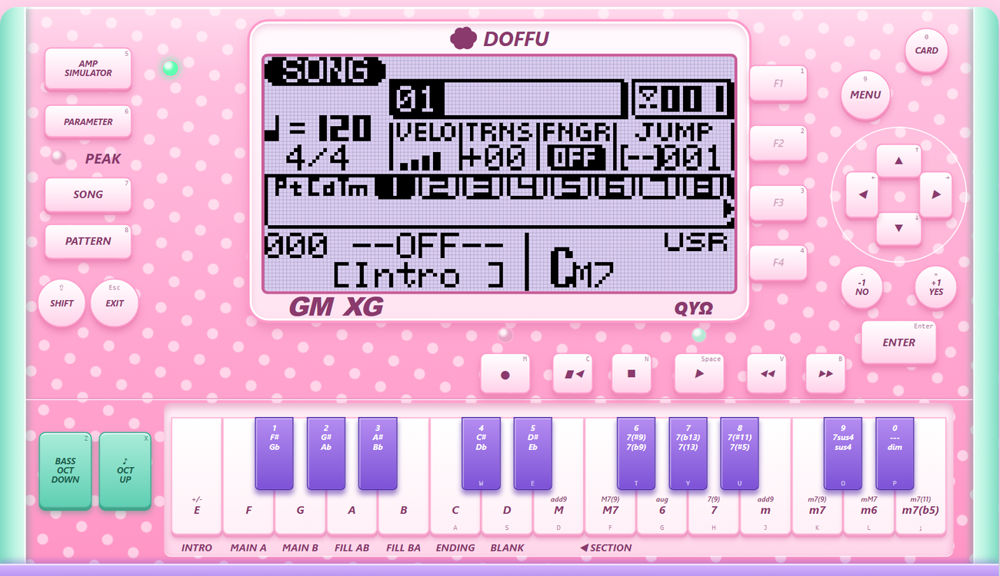
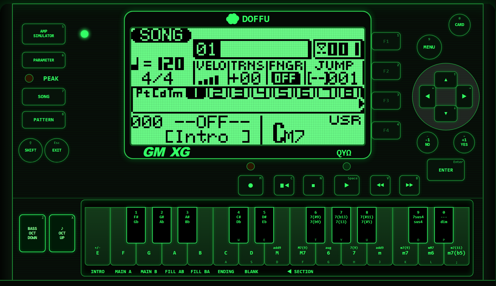
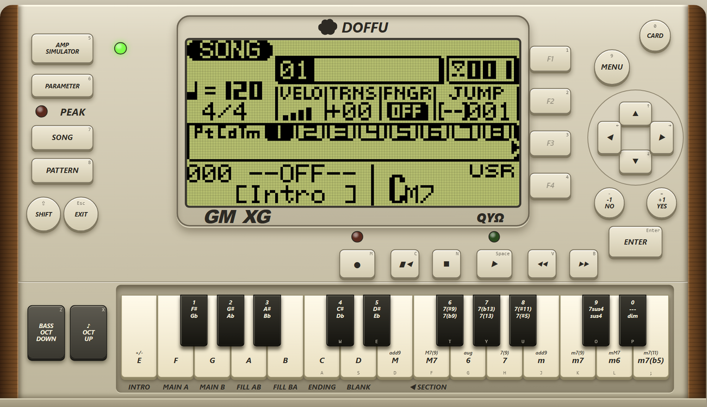

# QYΩ Emulator

A hardware sequencer emulator in Go and the browser.



The same unit in five looks, chosen from a dropdown on the page. Each look restyles the whole device,
including the lights, the volume fader and the screen tint.

| Frutiger Aero | かわいい (kawaii) |
| --- | --- |
|  |  |

| Terminal | Vintage |
| --- | --- |
|  |  |

This program runs the real firmware of a Yamaha hardware sequencer from 2000 (firmware version 1.37) on a
software model of its processor, and shows the result in a web page: the LCD, the front panel
buttons, the micro keyboard, the indicator lights, a SysEx drop zone and sound.

It is free software under the GNU General Public License v3.0 (see `LICENSE` and `NOTICE.md`).
It does **not** include Yamaha's firmware or any of the unit's own sounds. You supply the
firmware image yourself (see below).

Everything runs on your machine. The server only listens on the local loopback address (127.0.0.1)
and never opens a MIDI port itself. The optional Live MIDI card lets the page use MIDI ports that you
pick (see below); until you press Enable it does nothing.

## Set up in five steps

1. **Install Go** 1.24 or newer from https://go.dev/dl/ (nothing else is needed: no Python, no Node).
2. **Get the program.** Download or clone this folder, open a terminal in it and build:
   `go build -o emu .` (this makes `emu.exe` on Windows).
3. **Get the firmware yourself.** The program does not include it. You need Yamaha's version
   1.37 update file for the sequencer (the MIDI file from Yamaha's own downloads) or a 2 MiB flash image made from
   it. Use only a copy you are entitled to.
4. **Start it:** `./emu serve` (Windows: `.\emu.exe serve`) and open http://127.0.0.1:8100/ . The
   first page is a setup screen: drop the firmware file on it. The unit boots (about 35 seconds the
   first time, about a second after that) and the page turns into the emulator.
5. **Optional, for better sound:** put a General MIDI soundfont (`.sf2`, `.sf3`, `.dls`) in
   `soundfonts/` and pick it in the Soundfont list. GeneralUser GS by S. Christian Collins works well
   (https://www.schristiancollins.com/generaluser). Sound is off until you press the SOUND tab.

Trouble? `emu serve --fresh` rebuilds the saved start state, and deleting `boot.snap` does the
same. Everything runs on your machine; the server only answers on 127.0.0.1.

## What it is, and what it is not

| | |
| --- | --- |
| Main CPU | Emulated instruction by instruction (Renesas H8S/2600 core inside Yamaha's SWX00B chip). The firmware you see is Yamaha's own code, unmodified. |
| On chip peripherals | Timers (TPU 0 to 2), serial ports (SCI 0 to 2, the MIDI ports), interrupt controller, A/D converter. Registers nothing has needed yet read back what was written and are reported. |
| Board | T6963C style LCD controller, key matrix, indicator light latch, battery backed RAM (saved in a snapshot), the byte port to the sound CPU. |
| Not modelled | The sound chip and the wave ROM, the SmartMedia card port, the guitar and mic inputs, timer channels 3 to 5. The factory style ROM contents are not in the firmware image, so preset styles are empty. |
| Sound | Not the unit's own. The MIDI and XG bytes the main CPU sends the sound chip are played on a general purpose soundfont synthesizer (SpessaSynth). |
| Timing | Approximate. The CPU is paced to about real time using an inferred clock of 16.9344 MHz at 3 clocks per instruction. It is not cycle accurate. |
| Accuracy | Not yet measured against the real unit. It boots, takes keys, answers SysEx, plays patterns and draws the right screens, but a systematic comparison with recordings from the real hardware has not been done. |

So it is a real emulation of the unit's brain and screen, with the sound and some of the
surrounding hardware standing in. It is good for studying how the firmware works and for
testing SysEx and pattern data safely. It is not proof that something will behave the same on
the real device.

## Quick start

You need Go 1.24 or newer, and a firmware image (next section).

```
go build -o emu.exe .
.\emu.exe serve            # then open http://127.0.0.1:8100/
```

The first start has no `boot.snap`, so the firmware boots from reset. That takes about 35
seconds. The program dismisses the "Factory Set" popup, saves the state to `boot.snap` and
serves. Later starts restore `boot.snap` in about a second. `emu serve --fresh` rebuilds it.
`emu serve 127.0.0.1:8101` uses another port (only loopback addresses are accepted).

`boot.snap` is made from your firmware, so it is not distributed. Delete it whenever you change
firmware.

### Supplying the firmware

The program does not contain the firmware. There are two ways to give it yours:

* **From the page.** Start `emu serve` with no firmware in place and open the page. It shows a setup
  screen: drop Yamaha's version 1.37 update file (the MIDI file) or a 2 MiB flash image on it.
  The file is checked, saved next to the program as `sequencer_flash.bin` and the unit boots. The
  file is never sent anywhere else, and the page refuses uploads once a unit is running.
* **As a file.** Put the image in place yourself. The program looks for it in this order:
  1. the `QYOMEGA_FIRMWARE` environment variable, else
  2. `sequencer_flash.bin` next to the program, else
  3. `sequencer_flash.bin` in the folder above.

The image is 2 MiB with the file offset equal to the flash address. Yamaha's update file is a
stream of SysEx bulk blocks (7 bit packed, 21 banks of 64 KB starting at flash address 0x10000);
`ImageFromUpdate` in `firmware.go` turns it into the image and a test checks that the result is
identical to the one made by the toolkit's `re/build_image.py`. `../FINDINGS.md` describes the
update format. The first 64 KB of the real flash (the boot block) is never part of an update and
is filled with 0xFF, so the emulator starts at the reset handler (0xDCEEA) instead of fetching the
reset vector.

The command line tools (`emu dis`, `emu run` and so on) do not have the setup screen: they stop and
say so when the image is missing.

## The page

Open http://127.0.0.1:8100/ . The device is drawn like the front panel in the owner's manual,
with a screen about twice the original size.

* **Buttons and keys.** Click any panel button or key. A small letter on each button is the
  computer key that presses it, and several can be held at once, so Shift plus a digit works.
  On the micro keyboard you can press and drag across the keys for a glissando.
* **Lights.** The play light blinks with the beat, the AMP SIMULATOR light follows its button, the
  REC light is wired but not seen to change. The server timestamps every change of the light latch
  and the page replays them, so the blinks keep time.
* **Left strip.** Tabs that slide under the body: SOUND (off every time the page loads), POWER RESET
  (reboot, keeps memory), FACTORY RESET (blank memory, click twice), and a volume fader.
* **Look.** A dropdown picks the look of the whole device: Dark, Frutiger Aero, かわいい (kawaii),
  Terminal or Vintage. `?skin=aero` in the address overrides it for one visit.
* **Screen.** Pixel grid, invert, a colour picker and a brightness slider, each remembered per look.
  Reset look returns the current look to its defaults.
* **Soundfont.** The dropdown lists the built in synth and every `.sf2`, `.sf3`, `.dls` or `.sfogg`
  in `soundfonts/`. None is shipped; see `soundfonts/README.md` and `NOTICE.md`.
* **Live MIDI.** Press Enable on the Live MIDI card to pick a MIDI input (a keyboard or DAW feeds the
  unit's MIDI IN) and an output (what the unit sends). It uses the browser's Web MIDI without System
  Exclusive access, both ports start on None and nothing is remembered between visits. The output is
  filtered on the server (`midisafe.go`) with an allow list: notes, pitch bend, aftertouch and the
  ordinary performance controllers go out. Never sent: any SysEx (bulk dumps, XG and GM resets,
  parameter changes), System Reset, song position or select, bank select, RPN and NRPN, controllers
  120 to 127, and, unless you tick them, program changes and clock, start and stop. That includes
  everything the firmware sends during boot or a Factory Reset. The notes you
  send in come back out as the unit echoes them, so do not route the output to the same device as
  the input.
* **SysEx.** Drop a `.syx` file or paste hex text. Messages go to the emulated MIDI IN (never a real
  port), replies are listed, and a progress bar shows long uploads. A 30 KB pattern file (about 195 messages) loads in roughly
  14 seconds.
* **Debug.** The line under the soundfont list is the CPU program counter and the instruction
  count since power on.
* `?ad` hides everything below the device and fixes its size, for screenshots and screen recordings.

State such as songs and patterns lives in the emulated battery RAM. It survives Reset but is not
saved to disk, so restarting the program loses it.

## Command line tools

`emu` with no arguments lists them. The useful ones:

```
emu serve [--fresh] [ADDR]      the web page
emu dis HEXPC [COUNT]           disassemble from an address
emu run HEXPC COUNT             run, then list accesses to hardware that is not modelled
emu trace HEXPC COUNT [FROM]    registers after every instruction (very verbose, pipe it)
emu watch HEXPC COUNT LO HI     log writes to an address range with the pc that made them
emu profile HEXPC COUNT [SKIP]  hottest addresses outside the kernel
emu screen COUNT [..] [PNG]     run from reset and print or save the LCD
emu sysex BOOT GAP "F0 .."      boot, send SysEx to MIDI IN, print what the unit sends back
emu keys BOOT GAP KEY ..        boot, press keys (names like PLAY, SONG, k:C3), print the text layer
emu syx BOOT SETTLE OUT FILE..  boot, send .syx files in bulk mode, ask for pattern 1 back
emu snap BOOT FILE / restore    save or load the whole machine state
emu dump BOOT HEXADDR LEN       hex dump of memory after boot
```

## Tests

```
go test -short ./...    about 15 seconds
go test ./...           about 45 seconds, boots the firmware several times
```

The tests that need the firmware skip themselves if the image is missing. The suite covers
instruction decoding and semantics (including flags), interrupts, timers, serial ports, the LCD
modes, the key matrix and light log, snapshots, SysEx exchanges, the sound byte port, the HTTP
server and the voice map.

## Layout of this folder

| File or folder | Purpose |
| --- | --- |
| `main.go` | Command line entry point and the debug subcommands |
| `cpu.go`, `decode.go`, `decode_table.go`, `operand.go`, `step.go`, `step2.go`, `interrupt.go` | The H8S core: registers, decoder (table generated by `gen_table.py` from MAME), operands, instructions, interrupts |
| `bus.go`, `onchip.go`, `tpu.go`, `sci.go` | Memory map, on chip register window, timers, serial ports |
| `lcd.go`, `font5x7.go`, `keys.go`, `subport.go` | LCD controller, key matrix and light latch, byte port to the sound CPU |
| `firmware.go`, `setup.go`, `setup.html` | Finding the firmware image, converting Yamaha's update file to an image, and the setup page that takes the user's own firmware |
| `machine.go`, `snapshot.go` | The whole unit, power cycling, battery RAM, state snapshots |
| `sysex.go`, `serve.go`, `static.go` | SysEx exchange, the HTTP server, static files |
| `index.html` | The whole front end: faceplate, looks, keys, SysEx, sound hooks |
| `synth.js`, `sfengine.js` | Sound: MIDI and XG stream parser and engines (generic synth, soundfont via SpessaSynth) |
| `logos/` | The Doffu cloud logo, which is Doffu's own artwork and is **not** under the GPL (see `logos/LICENSE.txt`) |
| `vendor/` | Third party browser libraries, unmodified, with their licences |
| `soundfonts/` | Put soundfonts here. Holds the voice map for GeneralUser GS |
| `tools/buildvoicemap.py` | Builds the voice map that makes XG variation voices sound distinct |
| `EMU_STATUS.md`, `FRONTEND_STATUS.md` | The working logs: every finding, bug and decision, newest at the bottom |
| `ARCHITECTURE.md` | How it fits together, for people who want to change it |
| `scratch_panel/`, `scratch_ad/` | Throwaway scripts used while building the faceplate and a promo video. Safe to delete |

## Further reading

* `ARCHITECTURE.md`: memory map, devices, server API, front end internals, what was verified and
  what is assumed, and the mistakes that cost the most time.
* `EMU_STATUS.md` and `FRONTEND_STATUS.md`: the chronological logs.
* `../FINDINGS.md`: the firmware reverse engineering write up this is built on.
* `NOTICE.md`: credits and what is not covered by the GPL.

The Doffu cloud logo and the name DOFFU are Copyright (C) 2026 Doffu, all rights reserved, and are not
under the GPL. Yamaha and XG are trademarks of Yamaha Corporation. This is an independent project and
is not connected to Yamaha.
